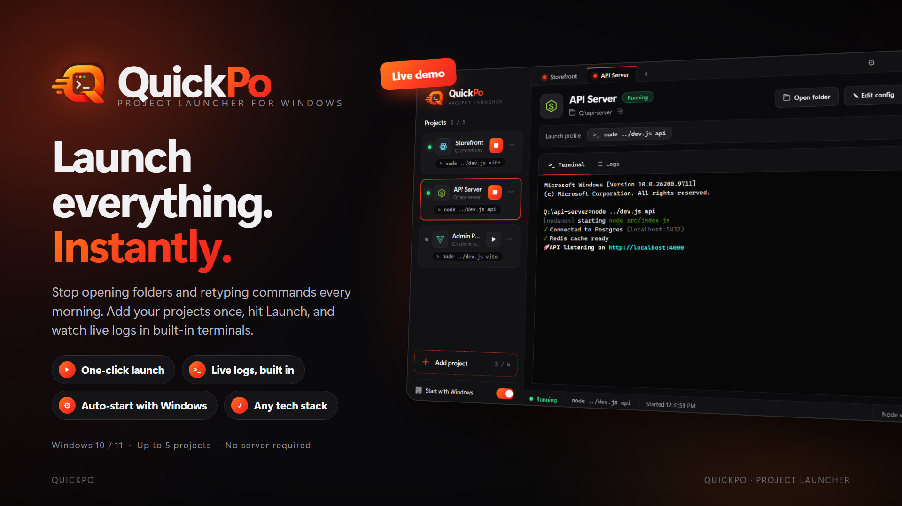

<p align="center">
  
</p>

<h1 align="center">QuickPo</h1>
<p align="center"><b>Project launcher for Windows.</b> Add your projects once, hit Launch, watch live logs in built-in terminals.</p>

<p align="center">
  <a href="https://github.com/Abhinav-Krishna-P/QuickPo/releases/latest"><b>⬇ Download the latest .exe</b></a>
  &nbsp;·&nbsp; Windows 10 / 11 &nbsp;·&nbsp; Any tech stack &nbsp;·&nbsp; Up to 5 projects &nbsp;·&nbsp; No server required
</p>

---

## Why QuickPo?

Every morning the same grind: open each project folder, open a terminal, type the start command, repeat for every project.
QuickPo removes that loop. Register a project once and it is one click away, with its console right inside the app.

## Features

| | |
|---|---|
| **One-click launch** | Press ▶ on a project card (or the big **Launch** button) and its start command runs in the project folder. |
| **Live logs, built in** | A real Windows console (ConPTY + xterm.js) per project: colours, interactive prompts and typing all work. A **Logs** tab shows a plain-text, time-stamped view. |
| **Auto-start with Windows** | Flip the toggle and QuickPo opens when you sign in. |
| **Auto-launch projects** | Mark a project *auto* and it starts as soon as QuickPo opens. |
| **Any tech stack** | QuickPo just runs the command you give it. Node, Vite, React, Laravel, Django, Go, Rust, Java, Docker Compose, anything. |
| **Smart defaults** | The start command is read from `quickpo.json` in the project root, or guessed from the project (package.json scripts, `artisan`, `manage.py`, `docker-compose.yml`, …). |
| **Stop / Restart** | Stop kills the whole process tree, so dev servers and their children really go away. |
| **Single instance** | Opening QuickPo again just focuses the running window. |

## Install

1. Go to the **[Releases page](https://github.com/Abhinav-Krishna-P/QuickPo/releases/latest)** and download the `.exe` attached to the latest release:
   - `QuickPo-<version>-x64-win.exe` – **installer** (adds a Start Menu entry and a desktop shortcut). Recommended.
   - `QuickPo-<version>-portable.exe` – **portable**, runs without installing.
2. Run the file. If Windows SmartScreen shows *"Windows protected your PC"*, click **More info → Run anyway**. The build is not code-signed yet, which is why SmartScreen asks.
3. Follow the installer (you can change the install folder), then launch **QuickPo** from the Start Menu or desktop.

Your project list and settings are stored in `%APPDATA%\QuickPo\projects.json`, so they survive reinstalls and updates.

To update, download the newer installer and run it over the existing installation. Close QuickPo first.

## Using QuickPo

1. Click **Add project** (or the **+** in the tab bar).
2. **Browse** to the project's root folder. The name and start command are filled in automatically; edit them if you like.
3. Optional: tick **Save command to quickpo.json** to pin the command in the project itself, and **Launch automatically when QuickPo opens** for projects you always need.
4. Press **Launch**. The console tab opens with the project folder as its working directory and the logs stream in.
5. **Stop** ends the process tree. **Launch** again restarts it. Switch between running projects with the tabs at the top.

### `quickpo.json`

Put this file in a project root to pin its start command (it wins over the automatic guess):

```json
{ "command": "npm run dev" }
```

Anything that works in `cmd.exe` works here, for example `docker compose up`, `php artisan serve`, `python manage.py runserver` or `yarn dev --port 3001`.

## Build from source

Requirements: Node.js 20+ and npm. No Visual Studio or Python needed; the native console module ships prebuilt.

```bash
git clone https://github.com/Abhinav-Krishna-P/QuickPo.git
cd QuickPo
npm install
npm start          # run the app in development
npm test           # unit tests (project store + command/stack detection)
npm run smoke      # headless end-to-end check: launches a project, exits 0 on success
npm run dist       # build dist/QuickPo-<version>-x64-win.exe and the portable exe
```

Stack: Electron, node-pty (ConPTY), xterm.js, electron-builder.

## Project layout

```
src/main/main.js       Electron main: window, IPC, auto-start, smoke/debug/record modes
src/main/store.js      projects + settings persistence (userData/projects.json)
src/main/detect.js     quickpo.json reader, start-command guesser, tech-stack detection
src/main/pty.js        one PTY per project, kills the process tree on stop
src/preload.js         contextBridge API exposed as window.quickpo
src/renderer/          sidebar, tabs, project header, terminal + logs view, dialogs
src/renderer/icons.js  tech-stack SVG icons
build/                 app icon
assets/                logo and poster
ad/                    launch video + poster sources (voice-over, SFX, composition, renderer)
test/                  node --test unit tests
```

## Troubleshooting

- **Blank window or missing cards** – update to the latest release; early builds had a rendering bug on first launch.
- **A project starts only partly** (for example a `concurrently` script where one half stays silent) – check that every service the project depends on (database, Supabase, Redis, …) is reachable; QuickPo only runs the command, it does not change your environment.
- **Project folder moved** – edit the project (✎) and browse to the new location.

## License

MIT
